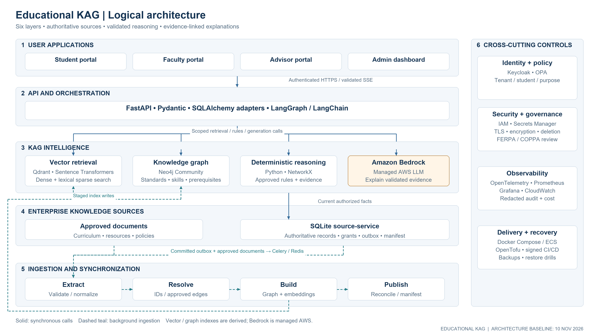
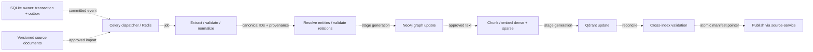
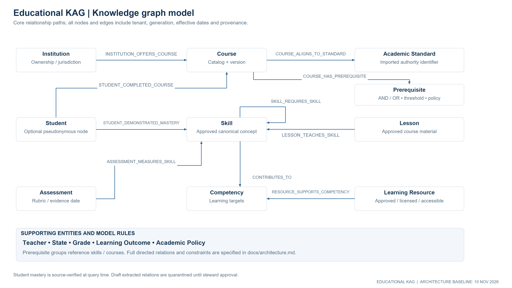
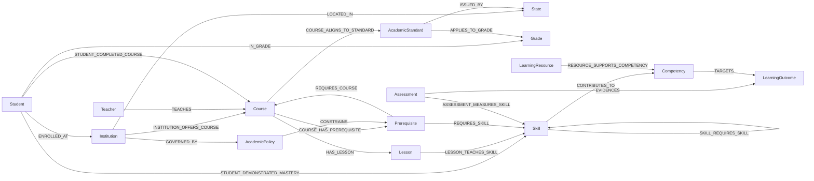
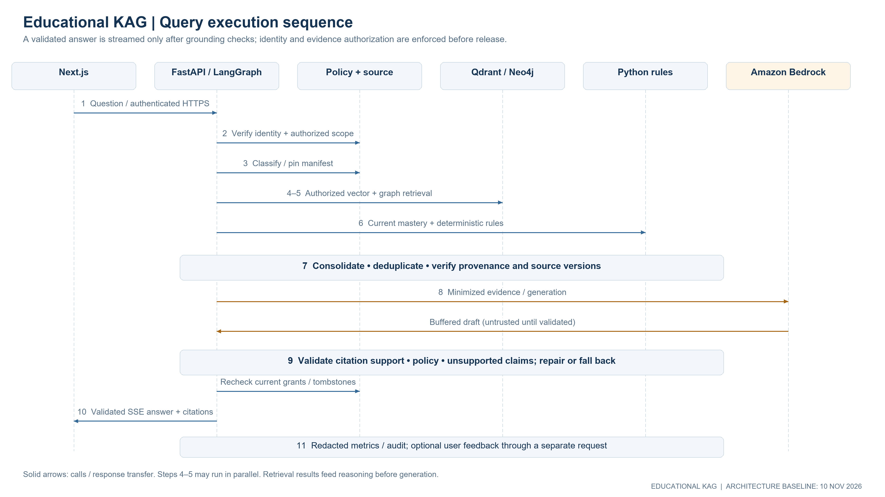
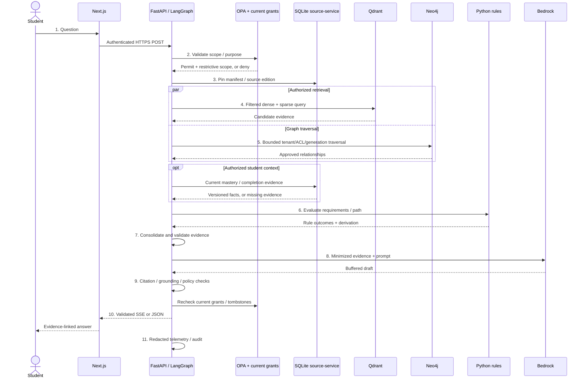
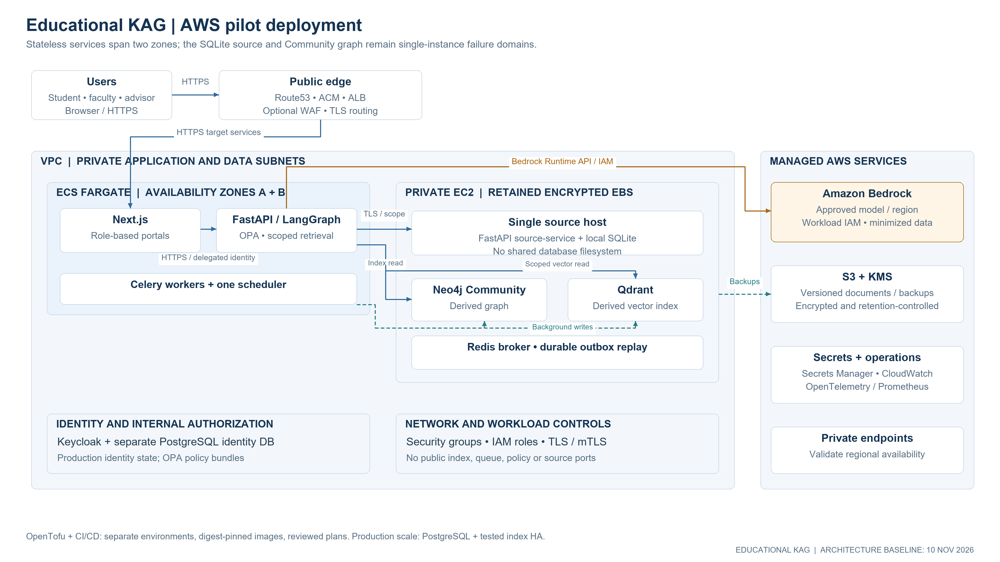

# US Educational Knowledge-Augmented Generation Platform

**Architecture baseline:** 10 November 2026 · **Status:** proposed design for a bounded pilot

## 1. Executive overview

Connect institutional education records, curriculum documents, semantic retrieval, and a provenance-rich knowledge graph through authenticated APIs.  
Use deterministic Python rules to evaluate academic requirements and Amazon Bedrock to explain validated evidence.  
Give students, faculty, advisors, and administrators accessible Next.js interfaces with source citations and explicit uncertainty.  
Begin with a single-host SQLite pilot, then migrate transactional storage and stateful services when measured scale or availability requires it.

**Three business benefits**

1. **Better learning support:** connect skill gaps to sequenced, curriculum-aligned resources, with teacher oversight.
2. **More consistent advising:** reuse institution-approved prerequisite and policy rules, with traceable evidence rather than unsupported answers.
3. **Lower integration friction:** maintain stable identifiers, API contracts, and replaceable retrieval and model adapters as the platform grows.

## 2. Scope, assumptions, and architectural decisions

The platform supports US K–12 districts, universities, and EdTech tenants. The first use case is curriculum Q&A and advisory learning paths, not automated enrollment or grading. Each tenant supplies authoritative standards, course catalogs, policies, and mastery interpretations. A state, academic year, catalog version, and applicable institution must be resolved before asserting an official requirement. If these are absent, provide general guidance and disclose the missing context.

Planning assumptions, **not measured capacity claims**: 1–3 pilot institutions, 10,000 curriculum/resource documents, up to 5,000 student records, 25 simultaneously active sessions, and modest serialized writes. Start with synthetic data. Evaluate performance with representative text sizes, graph fan-out, embedding hardware, and Bedrock quotas before admitting real users.

| Decision | Baseline | Consequence / production gate |
|---|---|---|
| Authoritative records | SQLite plus versioned source documents | Qdrant and Neo4j are rebuildable projections. Files, source versions, and approvals remain traceable. |
| SQLite owner | One internal FastAPI source-service process on one host | All SQL reads/writes and outbox commits pass through this owner; API replicas and Celery workers use its authenticated internal API. |
| Graph | Neo4j Community Edition | Single instance; enforce tenant/student authorization in application queries. No assumed native fine-grained RBAC or automatic HA. |
| Vector search | Qdrant dense + lexical sparse vectors | Explicit tenant/ACL filters on both branches; fuse rankings and evaluate retrieval quality. |
| Reasoning | Versioned deterministic Python modules | LLMs cannot create official facts, change mastery, or execute academic decisions. |
| Generation | Configurable Bedrock Converse adapter | Validate model access, regional policy, supported operations, context limits, and quotas in the target account. |
| Identity / policy | Keycloak OIDC + OPA | Authentication and authorization fail closed; an administrator role does not imply access to every student. |
| AWS pilot | ECS stateless tier + dedicated EC2 stateful hosts | Persistent host-managed encrypted EBS; single-host source service is a documented availability constraint. |
| Production growth | PostgreSQL source migration; independently scaled indexes | Maintain identifiers and repository interfaces; reassess graph isolation/HA and availability requirements. |

SQLite WAL has one concurrent writer and requires processes using a database to reside on the same host; it is not a shared filesystem database. This is why the architecture uses a source-service rather than mounting a database file into distributed API tasks. [SQLite WAL documentation](https://www.sqlite.org/wal.html), [SQLite network guidance](https://sqlite.org/useovernet.html).

Neo4j Community is GPLv3 and does not provide the enterprise HA and fine-grained security feature set. For stronger isolation, allocate a separate Community instance per tenant, or evaluate PostgreSQL + Apache AGE. Validate operational and Cypher compatibility rather than assuming a drop-in replacement. [Neo4j editions](https://neo4j.com/pricing/).

## 3. Logical architecture



[Editable SVG](../diagrams/logical-architecture.svg). All presentation diagrams use a 16:9 canvas and are provided as 3840 × 2160 PNGs. Solid arrows represent synchronous calls; dashed arrows represent background work. The control rail applies across all five functional layers. The six display layers group ingestion separately and combine cross-cutting security with operations, while retaining all responsibilities in the requested technology layers.

### Layer 1 — User applications

Next.js / React, TypeScript, Tailwind CSS, and shadcn/ui provide role-specific navigation: student learning portal; teacher/faculty portal; advisor portal; and administrator dashboard. Features include chat, course/curriculum search, evidence panels, learning recommendations, progress charts, an accessible graph explorer, and feedback. Use Cytoscape.js for graph visualization with a keyboard-accessible table alternative. Scope dashboards and graph counts as carefully as document text.

Use OIDC authorization code + PKCE. Prefer a Next.js backend-for-frontend session with HttpOnly, Secure, SameSite cookies and CSRF checks; its server forwards audience-bound access tokens to FastAPI over HTTPS. Do not persist tokens in browser local storage. Tenant switching requires an authorized membership. Browser requests remain same-origin through a TLS gateway. Personalization is opt-in within institution policy and its authorized educational purpose.

### Layer 2 — API and orchestration

FastAPI, Pydantic, SQLAlchemy, Uvicorn, LangGraph, and scoped LangChain adapters implement API contracts, typed state, and controlled retrieval. FastAPI verifies JWT signature, trusted issuer, audience, expiry, and approved algorithms; derives tenant from verified membership; asks OPA for purpose/role/student restrictions; and constructs an immutable `AuthorizedScope`. User-supplied tenant IDs never override this scope.

LangGraph nodes: `authorize → classify → pin_manifest → plan → retrieve_vector / retrieve_graph / read_source → reason → consolidate → generate → validate → deliver → audit`. Retrieval can run concurrently after authorization and snapshot selection. Tool selection is bounded by a server-side plan. Use timeouts, recursion and traversal limits, typed outputs, and an explicit partial-evidence state. LangChain provides document and Qdrant adapters; it is not a second overlapping agent loop. Persist checkpoints only where needed, encrypted and tenant-scoped, with short retention.

| Endpoint | Contract / policy |
|---|---|
| `POST /api/v1/kag/query` | `{question, student_id?, state?, grade?, course_id?, academic_year?, stream?}`; returns grounded answer, evidence, rule results, completeness, versions and trace ID. Student context requires an explicit access grant. |
| `POST /api/v1/kag/recommend` | `{goal, student_id?, constraints?}`; returns advisory ranked resources and learning sequence. No enrollment/grade writes. |
| `GET /api/v1/curriculum/standards` | Filter state, grade, subject, effective year, approved source version; cursor pagination. Return imported identifiers and provenance. |
| `GET /api/v1/students/{id}/learning-path` | Self, assigned teacher, or assigned advisor with relevant purpose; return current rule evaluation and evidence timestamps. |
| `GET /api/v1/knowledge/graph` | Server-approved entity IDs and bounded depth; filtered nodes/edges; no arbitrary Cypher. Hide unauthorized adjacency and counts. |
| `POST /api/v1/admin/ingestion` | Scoped ingestion permission; source reference and version; idempotency key; `202` with job ID. No untrusted remote fetch URLs. |
| `GET /api/v1/health` | Minimal public liveness only; internal authenticated readiness checks dependencies, policy bundle and active manifest. |
| Supporting endpoints | `GET /api/v1/admin/ingestion/{job_id}`, `POST /api/v1/feedback`, `GET /api/v1/evidence/{id}`, internal source/outbox APIs. Apply object-level authorization throughout. |

Validate input sizes and identifiers; reject unknown fields; bound pagination and graph depth. Use `401/403`, non-enumerating `404`, `409` for version/idempotency conflicts, `422`, `429` with retry advice, and `503` for essential unavailable dependencies. Record request IDs and return structured errors without source content.

**Streaming:** `POST` using fetch streaming and `text/event-stream` (native browser EventSource does not POST). Send `status` and heartbeat events during work. Buffer the Bedrock draft, validate it, then emit validated answer chunks followed by `evidence` and `done`; do not expose raw, unchecked model tokens. Include event sequence IDs, request ID and cancellation. This trades immediate token latency for validation. Incremental sentence release requires a separate validated design. Disable proxy buffering and response caching, bound idle timeouts, and recheck permissions before evidence emission. Retry creates a new authorized request; persisted resumable streams are outside pilot scope.

### Layer 3A — Vector retrieval engine

Qdrant stores curriculum, course descriptions, lessons, assessment explanations and approved policies. Keep student-level mastery out of embeddings by default; use direct authorized source reads for that data. Sentence Transformers loads a reviewed Hugging Face model artifact locally. Evaluate `sentence-transformers/all-MiniLM-L6-v2` as a small English-language baseline, not a production accuracy claim; validate its pinned model revision and model-card license separately from the library. Restrict model artifact downloads to CI, disable unreviewed remote code, and distribute signed/cached artifacts to runtime.

Chunk by heading and semantic unit; initial tuning range 350–600 tokens with 50–80 token overlap. Preserve page/section offsets, heading hierarchy, and rubric/table boundaries. Do not split an academic requirement across isolated chunks. Configure embedding model revision, dimension, normalization and distance metric together. A changed model or chunker creates a new index generation.

Hybrid retrieval requires **both** a dense embedding branch and a lexical sparse branch (e.g. locally computed BM25 sparse vectors through a reviewed FastEmbed integration). A dense-only collection is not hybrid search. Apply the same scope and generation filters to both branches, retrieve a tuned candidate pool, fuse using reciprocal rank fusion, and optionally rerank authorized text with a reviewed local cross-encoder. Candidate counts and thresholds are evaluation settings. [Qdrant hybrid query documentation](https://qdrant.tech/documentation/search/hybrid-queries/).

Required payload: `tenant_id`, `entity_id`, `document_id`, `chunk_id`, `state`, `grade`, `course_id`, `standards_ids`, `source_version`, `generation_id`, `auth_scope`, `acl_group_ids`, `effective_from`, `effective_to`, `source_uri`, `page`, `section`, `content_hash`. Add indexed payload fields for mandatory filters. Shared public standards are copied into tenant projections for simple isolation; do not use an unrestricted OR branch for public data. Qdrant filters implement the application policy decision; they are not a substitute for it. [Qdrant multitenancy](https://qdrant.tech/documentation/manage-data/multitenancy/).

### Layer 3B — Knowledge graph engine

Neo4j holds approved curriculum topology, institutional offerings and policies, plus optional pseudonymous mastery projections. SQL remains authoritative for current student status. Restrict Bolt to backend security groups; users never access it. Readers and ingestion writers use separate service credentials where edition capabilities permit; do not assume Community has enterprise database roles. Use fixed parameterized Cypher templates, allowlisted labels and relations, query timeouts, and result limits. Every node and edge carries tenant and generation restrictions; constrain intermediate path nodes, not only endpoints.

Entity resolution uses scoped canonical IDs and reviewed source mappings. Never merge students by name or infer mastery from chat. Candidate LLM-extracted edges enter quarantine; validators check endpoint existence, tenant, edge type, temporal validity, evidence, and cycles before a curriculum steward approves publication.

### Layer 3C — Knowledge reasoning engine

Versioned Python rule modules, Pydantic facts and NetworkX subgraphs evaluate prerequisites, curriculum alignment, competency gaps, and learning paths. Fetch only a bounded authorized subgraph into NetworkX. Detect cycles and contradictory prerequisite rules; topologically sort prerequisite DAGs. Represent course requirements as explicit AND/OR groups, minimum scores, transfer equivalencies, waivers, and catalog effective dates. A bare list of edges is insufficient for real university eligibility.

Use three-valued outcomes: `satisfied`, `not_satisfied`, `unknown`. Missing or expired evidence is unknown, not failure. Mastery thresholds, assessment recency, accommodations and retake/transfer interpretations are institution-approved policies, not hard-coded national norms. Consequential outputs are decision support requiring authorized human confirmation and an appeal route. Enrollment, grading and eligibility changes remain in the institution's governed transaction workflow.

### Layer 3D — LLM generation engine

Call Bedrock through Boto3 `bedrock-runtime` with `AWS_REGION`, `BEDROCK_MODEL_ID`, bounded timeouts and retries. Use `Converse` or supported `ConverseStream` only after account/region capability checks. Some model-specific features vary; verify support instead of assuming universal structured output or streaming. Model access, provider prerequisites, quotas and request routing must be validated in the target account. [Bedrock Converse](https://docs.aws.amazon.com/bedrock/latest/userguide/conversation-inference.html).

Prompt structure: immutable instruction and output schema; user question; explicitly delimited untrusted source excerpts; approved fact and rule records; allowed citation IDs; required uncertainty and advisory language. Excerpts are evidence, never instructions. Generation has no SQL/Cypher execution credentials and no write tools. Minimize or pseudonymize student context before egress; a model does not need a student's name to explain a skill gap.

Budget tokens per model and tenant: reserve system/schema and output capacity first, then select authorized evidence by relevance and provenance; never silently drop required rule evidence. Cap output, set a low temperature only where supported, and record model/request configuration. Validate JSON structure, citation membership, policy language, and every consequential factual claim against the evidence bundle. Unsupported claims cause removal, one bounded repair, or a deterministic evidence-only response. An LLM judge may supplement these checks but is not the sole grounding control.

Confidence is an evidence-quality assessment, not a similarity score or the LLM's self-rating. Report coverage, missing requirements, source freshness, contradictory records, and a rubric-derived `high/moderate/insufficient` completeness label. No valid evidence means abstention; Bedrock failure returns a structured rule/evidence summary when safe. Authorization failure stops the request entirely.

## 4. Knowledge sources, schema, and provenance

### Authoritative relational model

SQLite uses foreign keys, WAL, short transactions, a bounded busy timeout, local encrypted block storage, migrations, and online backup APIs. All writes pass through the source-service; it owns SQLAlchemy sessions and transaction boundaries. Documents are versioned local files in development and encrypted S3 objects on AWS. SQLite stores their metadata and approval status; document content remains authoritative at its cited version.

| Table | Essential fields / purpose |
|---|---|
| `institutions` | tenant, institution ID, state, academic calendar and policy set |
| `students` | tenant-scoped student ID, institution, grade, restricted demographic references |
| `teachers` | tenant-scoped teacher ID and institutional identity mapping |
| `courses` | course ID, institution, catalog version, subject and effective dates |
| `lessons` | lesson ID, course ID, sequence, approved document references |
| `curriculum_standards` | imported standard ID, state, subject, grade, authority URI, source edition and verbatim text |
| `assessments` | assessment ID, course, rubric version, skill mappings |
| `student_progress` | student, course/skill/assessment, result, evidence date, mastery interpretation version |
| `competencies` | competency ID, description, approved skill decomposition |
| `prerequisites` | course/skill requirement, AND/OR group, threshold, equivalency, effective dates and policy source |
| `academic_policies` | institution, policy version, applicability, approval and document reference |

Add `tenants`, `memberships`, `student_access_grants`, `teacher_assignments`, `advisor_assignments`, `states`, `grades`, `skills`, `learning_outcomes`, `learning_resources`, `course_completions`, `course_standards`, `lesson_skills`, `assessment_skills`, `resource_competencies`, `documents`, `source_versions`, `entity_mappings`, `outbox`, `ingestion_jobs`, `index_manifests`, `deletion_tombstones`, and retention-controlled `audit_events` / `feedback`. SQLite has no native row-level security: enforce tenant predicates in repositories and use composite tenant foreign keys/uniqueness to prevent cross-tenant associations. Test this enforcement independently.

### Identity and evidence envelope

Assign an immutable canonical entity UUID; external IDs are mappings scoped by tenant, source system, entity type, and source key. Do not reuse deleted IDs. A record version is separate from identity. A vector point ID is a deterministic UUIDv5 over tenant + entity + source version + chunk offset + embedding revision + generation. Each graph node uses `(tenant_id, entity_id, generation_id)` uniqueness; edge identity includes relation, endpoints, evidence reference and generation. Shared concepts retain an authority mapping but tenant-specific projection keys.

Each fact includes `fact_id`, subject/predicate/object or typed fields, `tenant_id`, `source_record_id`, `source_version`, document URI and page/section, `content_hash`, `effective_from/to`, `observed_at`, `approved_by`, and `generation_id`. An evidence ID resolves through the API after fresh authorization; internal S3 paths and unrestricted presigned URLs are never placed directly in model output.

| Response category | Meaning | Example |
|---|---|---|
| `authoritative_fact` | Approved, imported record; no new assertion invented by extraction | Course catalog specifies prerequisite skill, with edition and section. |
| `rule_result` | Deterministic computation over cited facts and policy | A prerequisite is unknown because its assessment evidence is missing. |
| `ai_inference` | Generated explanation or pedagogical suggestion | Practice ratios before linear relationships; advisory and evidence-linked. |

An extraction confidence does not confer authority. Draft mappings and inferred edges cannot be used as official requirements until approved.

## 5. Ingestion and synchronization



This pipeline runs independently of chat requests. An authorized ingestion submission returns a job reference; it never indexes synchronously on a chat request. PyMuPDF or Unstructured extracts text and layout in isolated workers with CPU/memory/time/file-size limits, malware screening and blocked outbound fetches. OCR, when needed, adds a reviewed Tesseract dependency. Restrict allowed source URI schemes and S3 prefixes to avoid SSRF.

1. Commit source changes and an outbox event in the **same SQLite transaction**. Source writes cannot depend on Redis availability. A poller leases events through the source-service and dispatches Celery tasks; lost dispatches are retried.
2. Deduplicate at-least-once delivery with `(tenant, entity, source_version, operation, pipeline_revision)` and an immutable job ledger. Persist job outcomes in the source-service rather than relying on Redis task-result history. Use JSON task serialization; never pickle untrusted payloads.
3. Pin a consistent source snapshot/high-water mark. Extract, normalize IDs, validate relations, and route ambiguous records to steward review. Preserve external authority identifiers exactly.
4. Build a **complete tenant generation** in staging: start with a copy of the last published graph/vector projection and apply changed records, or rebuild fully for a small pilot. Incremental processing must retain unchanged records. Do not change a shared alias or mutate active edges during staging.
5. Apply graph upserts, then dense/sparse vector updates. Tombstones remove records, chunks and incident edges from the staged generation. Reject older version events and concurrent publication through per-tenant locks plus manifest compare-and-swap. Duplicate operations converge.
6. Verify expected counts, source hashes, endpoint references, tenant labels, missing embeddings, orphan edges, ACL metadata, embedding dimensions, delete completion and representative retrieval/rule tests. Graph/vector completion alone is insufficient.
7. Atomically change the tenant's active manifest **in SQLite** only after both projections pass. Manifest contains source snapshot, graph generation, Qdrant collection/generation, embedding revision, chunker revision and rule version. There is no distributed transaction across three databases. Queries pin the manifest once and explicitly filter that generation in both indexes; never resolve two independently switched aliases.
8. Retain the previous generation until in-flight requests expire, then remove according to retention policy. Roll back via an approved manifest CAS, provided it does not resurrect deleted or revoked content. Run scheduled source-to-index reconciliation and rebuild damaged projections from authoritative versions.

Exponential backoff with jitter, bounded attempts, poison-job quarantine, per-tenant ordering, queue depth and oldest-event alerts are required. A worker crash after one index write cannot publish half a generation. Celery periodic scheduling runs as one beat instance. Redis AOF improves queue durability, but the outbox remains the replay source.

**Deletion and revocation are not delayed by index publication:** the current source ACL and tombstone denylist apply during retrieval and again before display, including older pinned generations. Source reads provide current student facts, while catalog queries use their pinned edition; the response records both timestamps. Recheck current official rules for consequential advisory results. Purge caches, checkpoints, document copies and embeddings; maintain minimal deletion proof. Restore procedures replay tombstones before reopening service, and expired backups age out under policy.

## 6. Knowledge graph entity–relationship model



The PNG shows the core curriculum and student paths. The complete directed model follows; labels on arrows are the actual relation names. Cardinalities are generally many-to-many except a tenant-scoped record's single owning institution and a standard edition's jurisdiction. Required/optional participation is validated from source constraints, not inferred from a drawing.



`Prerequisite` is a reified requirement/group entity, supporting provenance, AND/OR operators and thresholds. An additional shortcut course-to-course edge is allowed only if derived from the same validated requirement; it cannot silently replace grouped rules. Mastery/completion edges carry evidence dates, source assessments, policy versions and revocation state. Optional student nodes contain pseudonymous IDs, not names. All listed entities include tenant, canonical ID and generation; every relation includes evidence and effective dates.

Example approved traversal template (internal parameterized query, not a public query interface):

```cypher
MATCH (c:Course {tenant_id: $tenant, entity_id: $course,
                 generation_id: $generation})
      -[cp:COURSE_HAS_PREREQUISITE]->(p:Prerequisite)
      -[rs:REQUIRES_SKILL]->(s:Skill)
WHERE p.tenant_id = $tenant AND s.tenant_id = $tenant
  AND p.generation_id = $generation AND s.generation_id = $generation
  AND cp.tenant_id = $tenant AND rs.tenant_id = $tenant
  AND cp.generation_id = $generation AND rs.generation_id = $generation
  AND p.entity_id IN $allowed_requirement_ids
  AND s.entity_id IN $allowed_skill_ids
RETURN c.entity_id, p.entity_id, p.rule_group, s.entity_id, rs.evidence_id
LIMIT 100
```

The server derives allowlists from approved scope; include effective-date and current revocation predicates in the repository. For multi-hop queries, check `all(nodes(path))` **and** `all(relationships(path))` against tenant, generation and ACL conditions, with a fixed maximum depth. Never retrieve an unrestricted path and redact afterward.

## 7. End-to-end KAG query workflow



1. **Student submits a question** from the Next.js portal with optional authorized learning context.
2. **FastAPI authenticates and determines scope** with Keycloak token validation, OPA policy, current student assignments, and tenant membership.
3. **LangGraph classifies and plans retrieval**, resolves jurisdiction/catalog context, and pins an active manifest.
4. **Qdrant retrieves curriculum/materials** through filtered dense and sparse retrieval.
5. **Neo4j retrieves standards, skills and prerequisites** through approved, bounded traversals. Steps 4 and 5 may run concurrently after authorization.
6. **Python reasoning evaluates academic rules**, using current authorized source-service mastery facts, approved catalog facts and explicit unknowns.
7. **Evidence is consolidated, deduplicated and validated** against provenance, temporal validity, source hashes and current access.
8. **Bedrock generates a grounded response** from minimized facts, rule results and allowed evidence IDs.
9. **The response is checked** for citations, unsupported claims and policy; any repair is bounded and validated again.
10. **FastAPI returns the result** and authorized evidence through validated SSE chunks or JSON to Next.js.
11. **Metrics, feedback and permitted audit metadata are recorded**; feedback is submitted separately when provided. Logs never include raw student prompts by default.



These Mermaid return arrows follow sequence-diagram notation; the presentation PNG legend distinguishes calls from local processing. It is not the asynchronous ingestion diagram.

## 8. Grade 7 → Algebra I worked example

**Question:** “Which mathematics topics should a Grade 7 student study before beginning Algebra I?”

**Illustrative context:** a synthetic district has imported a chosen state's adopted standards edition, its own Algebra I course outline, and licensed lesson resources. No state or real student's mastery was supplied with this request. Consequently the following is a demonstration, **not an assertion about any state's official requirements or a real student**. Production citations resolve to imported records; placeholder IDs below are deliberately not official standard codes.

Retrieval first selects the authorized tenant's state, standards edition, subject, grade and intended course. If jurisdiction is missing, the live product asks for it or labels the response as general readiness guidance. Exact standard IDs are copied from the imported authority; similarity search never invents or substitutes identifiers. The graph follows `Algebra I → requirement groups → prerequisite skills → prerequisite skills` and joins standards/resource mappings. The source-service reads mastery only when the user has permission for the requested student; otherwise the system gives a generic sequence without implying access to a student record.

| Stage | Recommended topic | Why / graph and rule evidence | Synthetic mastery and action | Illustrative citation |
|---|---|---|---|---|
| 1 | Rational numbers: fractions, decimals, signed arithmetic | Approved course-skill mapping identifies fluency used in expressions and equations. | Current evidence meets local policy; brief review. | `[COURSE-DEMO §2]`, `[STANDARD-PLACEHOLDER-A]` |
| 2 | Ratios, rates and proportional reasoning | Skill links support interpreting quantities and later linear relationships. | No recent evidence: `unknown`; offer diagnostic, not a failing label. | `[STANDARD-PLACEHOLDER-B]`, `[RESOURCE-DEMO-02 §1]` |
| 3 | Variables, expressions and distributive property | Prerequisite graph links expression structure to equation solving. | Synthetic evidence below the institution's approved target; guided practice. | `[COURSE-DEMO §3]`, `[RESOURCE-DEMO-03 §2]` |
| 4 | One- and two-step equations and inequalities | Requires signed arithmetic and expression manipulation; rule engine orders predecessors first. | Missing evidence: diagnostic then targeted practice. | `[COURSE-DEMO §3]`, `[RESOURCE-DEMO-04 §1]` |
| 5 | Coordinate plane, tables and introductory linear relationships | Course readiness mapping connects proportional reasoning and equation representations. | Schedule after supporting skills; teacher reviews readiness. | `[COURSE-DEMO §4]`, `[RESOURCE-DEMO-05 §2]` |

Resources are selected from approved institution/OER records by skill coverage, accessibility, grade appropriateness, language, license, and availability—not solely vector score. No live source resources or state standards were imported in this design exercise. The resource IDs above describe seeded demo fixtures to create during the pilot, not links to existing authoritative materials.

**Example response:** “A useful preparation sequence is rational-number arithmetic, proportional reasoning, expressions, equations, and coordinate/linear representations. In this demonstration, the course outline connects expressions to equations [COURSE-DEMO §3]. The rules place arithmetic and expressions before equation practice [RULE-DEMO-01]. Your authorized synthetic record has no recent proportional-reasoning evidence, so start with a diagnostic rather than assuming a gap. This is advisory preparation; your teacher or advisor confirms placement.”

The interface displays separate panels for **imported facts**, **rule results**, and **AI suggestions**. Do not show a synthetic mastery statement outside a clearly labeled demo environment. An actual answer must replace every placeholder citation with an authorized imported record; if this cannot be done, withhold official state-specific claims.

## 9. AWS deployment architecture



### Bounded pilot topology

Use separate development, staging and production accounts or equivalent strict boundaries. Route53 / ACM and an internet-facing ALB terminate public TLS; redirect HTTP and optionally use AWS WAF. Next.js and FastAPI run as private ECS Fargate services across two availability zones. Use HTTPS target groups with a managed internal certificate lifecycle, or an authenticated TLS service-mesh/gateway design; ALB termination alone does not encrypt every internal hop. The source-service and all backend service traffic use TLS/mTLS gateways. Keycloak is reachable through its public login route; OPA, source API, queues and index ports have no public route.

Dedicated private EC2 hosts run the source-service + SQLite, Neo4j Community, Qdrant, and Redis with retained encrypted **host-managed EBS** volumes. These may share hosts during synthetic testing, with resource isolation; isolate them for real-data operation and capacity measurement. Container restarts remount the host's stable filesystem. All processes opening SQLite reside on its source host. Fargate workers access records through the source API and objects through S3, not a shared SQLite mount. Source host recovery requires fencing the old writer, restoring/remounting storage, and re-registering the internal endpoint.

Do not assume ECS service-managed EBS retains a database through task replacement: AWS documents that volumes attached to service-managed tasks are deleted at termination. This design uses dedicated EC2-managed persistent volumes and explicit recovery automation instead. [ECS EBS lifecycle](https://docs.aws.amazon.com/AmazonECS/latest/developerguide/configure-ebs-volume.html).

Keycloak uses a separate PostgreSQL identity database in AWS, preferably managed RDS Multi-AZ when required. This database stores identity state, not the initial educational knowledge source. Local Keycloak development mode uses its own persisted development store. OPA is colocated with API replicas or supplied through an authenticated internal policy service, with signed/versioned policy bundles. Redis is the Celery broker; outbox replay is mandatory. Staging rebuilds use a separate write identity and bounded worker pools.

IAM task roles permit only required Bedrock invocation/model resources, Secrets Manager secrets and S3 prefixes. Use workload roles instead of static access keys; Boto3's default credential chain serves both local short-lived credentials and AWS roles. Use Bedrock Runtime, S3, ECR, logs and secrets VPC endpoints where available. Validate regional support and endpoint policies. Bedrock invocation occurs only server-side. Disable cross-region inference routing until data-location approval; some inference profiles can route across regions, so an environment region alone does not establish residency.

Bedrock remains a managed AWS service even when application components are open-source. Review model/provider terms, AWS data handling (including abuse detection), optional invocation logging, encryption and the institution's data agreement. Never promise blanket retention or compliance based on architecture alone. [Bedrock data protection](https://docs.aws.amazon.com/bedrock/latest/userguide/data-protection.html).

### Scaling and production path

Scale stateless API/UI and workers independently with tenant quotas and queue-age signals. Bound workers to source-service/index write capacity. Single-instance SQLite and Neo4j are failure domains, so the pilot is not multi-AZ highly available. ECS placement across zones does not remove those constraints. For production, migrate educational transactions to PostgreSQL with RLS as defense in depth; reconcile counts, hashes, constraints and rule outputs; use a controlled write freeze/cutover rather than uncontrolled dual writes. Keep canonical IDs and switch repository adapters.

Evaluate Qdrant replication and shard placement using its open-source cluster capabilities. For graph HA with an open-source-only requirement, evaluate Apache AGE on an HA PostgreSQL topology and test graph semantics/performance; Neo4j Enterprise is a separately licensed alternative if the requirement changes. EKS with EBS CSI StatefulSets is an alternative for a team that already operates Kubernetes; a single SQLite pod still has a single-writer failure domain and EBS attachment is zone-bound. Do not add EKS solely to disguise these limits.

### OpenTofu layout and delivery

Proposed IaC structure: `infra/modules/{network,edge,ecs,source_host,index_hosts,identity,secrets,storage,observability}` and `infra/environments/{dev,staging,prod}`. Parameters include allowed regions, model ARN/profile, tenant isolation mode, EBS sizes/IOPS, backup policy, retention, log redaction, image digests, budgets and endpoints. Use encrypted remote state with locking and restricted access; state can contain sensitive material. Prefer secret references over putting secret values in IaC state. No deployable IaC or provisioned resources are claimed in this package.

CI/CD: lint/type/unit → repository authorization and rule tests → synthetic retrieval/ingestion integration → license/SBOM, vulnerability and secret scans → image signing/push → OpenTofu format/validate/plan review → staging deploy → contract/load/accessibility/restore tests → governed production rollout. Use short-lived OIDC pipeline credentials, digest-pinned images, DB migration checks and backward-compatible APIs. Roll back images and manifests independently; do not automatically revert source migrations or deletions.

## 10. Technology stack, licensing, and alternatives

Licenses below describe upstream projects, **not every transitive dependency or hosted edition**. Freeze exact versions/model revisions and run SBOM/license review before distribution. Links point to primary projects/license files; permissive alternatives are design options, not equivalent tested replacements.

| Capability | Technology / upstream license | Alternative / decision |
|---|---|---|
| UI | [React](https://github.com/facebook/react/blob/main/LICENSE), [Next.js](https://github.com/vercel/next.js/blob/canary/license.md) — MIT | React + Vite, MIT; retain API contracts. |
| Types / styling | [TypeScript](https://github.com/microsoft/TypeScript/blob/main/LICENSE.txt) — Apache-2.0; [Tailwind](https://github.com/tailwindlabs/tailwindcss/blob/main/LICENSE), [shadcn/ui](https://github.com/shadcn-ui/ui/blob/main/LICENSE.md) — MIT | CSS modules; copied UI components still require notices and dependency review. |
| API / validation | [FastAPI](https://github.com/fastapi/fastapi/blob/master/LICENSE), [Pydantic](https://github.com/pydantic/pydantic/blob/main/LICENSE) — MIT; [Uvicorn](https://github.com/encode/uvicorn/blob/main/LICENSE.md) — BSD-3-Clause | Django/DRF, BSD; Flask, BSD. |
| Relational access / source | [SQLAlchemy](https://github.com/sqlalchemy/sqlalchemy/blob/main/LICENSE) — MIT; [SQLite](https://sqlite.org/copyright.html) — public domain | PostgreSQL, PostgreSQL License. |
| Workflow / integrations | [LangGraph](https://github.com/langchain-ai/langgraph/blob/main/LICENSE), [LangChain](https://github.com/langchain-ai/langchain/blob/master/LICENSE) — MIT | Explicit Python state machine; Haystack, Apache-2.0. |
| Vector store | [Qdrant](https://github.com/qdrant/qdrant/blob/master/LICENSE) — Apache-2.0 | pgvector, PostgreSQL License; Milvus, Apache-2.0. |
| Embeddings | [Sentence Transformers](https://github.com/huggingface/sentence-transformers) and [Transformers](https://github.com/huggingface/transformers/blob/main/LICENSE) — Apache-2.0 | Reviewed ONNX artifacts; **model weights/datasets have separate terms**. |
| Lexical search | [FastEmbed](https://github.com/qdrant/fastembed/blob/main/LICENSE) — Apache-2.0 | SQLite FTS5 for pilot lexical search, with explicit score fusion. |
| Graph | [Neo4j Community](https://neo4j.com/licensing/) — GPLv3 | [Apache AGE](https://github.com/apache/age/blob/master/LICENSE) — Apache-2.0 on PostgreSQL. |
| Deterministic reasoning | [Python](https://docs.python.org/3/license.html) — PSF; [NetworkX](https://github.com/networkx/networkx/blob/main/LICENSE.txt) — BSD-3-Clause | Explicit graph algorithms; no LLM required for official rules. |
| PDF / document ETL | [PyMuPDF](https://github.com/pymupdf/PyMuPDF/blob/main/COPYING) — AGPLv3, commercial option; [Unstructured core](https://github.com/Unstructured-IO/unstructured/blob/main/LICENSE.md) — Apache-2.0 | pypdf, BSD-3-Clause; pdfplumber, MIT. Review OCR/parser native dependencies. |
| Async jobs | [Celery](https://github.com/celery/celery/blob/main/LICENSE) — BSD-3-Clause; [Redis 8](https://github.com/redis/redis/blob/8.0/LICENSE.txt) — choose AGPLv3 for open-source route, or RSALv2 / SSPLv1 under their terms | [Valkey](https://github.com/valkey-io/valkey/blob/unstable/COPYING), BSD-3-Clause, after Celery transport compatibility tests; RabbitMQ, MPL-2.0. |
| Identity / policy | [Keycloak](https://github.com/keycloak/keycloak/blob/main/LICENSE.txt), [OPA](https://github.com/open-policy-agent/opa/blob/main/LICENSE) — Apache-2.0 | Authentik, MIT core; Casbin, Apache-2.0. |
| Telemetry | [OpenTelemetry](https://github.com/open-telemetry/opentelemetry-collector/blob/main/LICENSE), [Prometheus](https://github.com/prometheus/prometheus/blob/main/LICENSE) — Apache-2.0; [Grafana OSS](https://github.com/grafana/grafana/blob/main/LICENSE) — AGPLv3 | Jaeger, Apache-2.0, for optional trace storage; hosted CloudWatch is AWS proprietary. |
| Graph UI / TLS edge | [Cytoscape.js](https://github.com/cytoscape/cytoscape.js/blob/unstable/LICENSE) — MIT; [Caddy](https://github.com/caddyserver/caddy/blob/master/LICENSE) — Apache-2.0 | Accessible table; NGINX, BSD-2-Clause. |
| Containers / IaC | [Moby](https://github.com/moby/moby/blob/master/LICENSE), [Compose](https://github.com/docker/compose/blob/main/LICENSE) — Apache-2.0; [OpenTofu](https://github.com/opentofu/opentofu/blob/main/LICENSE) — MPL-2.0 | Podman, Apache-2.0; Docker Desktop has separate commercial subscription terms. |
| Managed generation / AWS SDK | Bedrock, IAM, S3, ECS, EBS, Secrets Manager, CloudWatch — AWS commercial service terms; [Boto3](https://github.com/boto/boto3/blob/develop/LICENSE) — Apache-2.0 | Keep a generator interface, but Bedrock is the required production LLM path. |

Redis 8 is not accurately described as BSD-only. Choose its AGPLv3 option with appropriate review if retaining Redis under the open-source requirement. PyMuPDF, Neo4j, Grafana and Redis require specific copyleft/distribution review; process separation alone is not a legal conclusion. Review precise versions and deployment/distribution arrangements with counsel. [Redis 8 license](https://raw.githubusercontent.com/redis/redis/8.0/LICENSE.txt), [Grafana license](https://raw.githubusercontent.com/grafana/grafana/main/LICENSE), [PyMuPDF license](https://github.com/pymupdf/PyMuPDF/blob/main/COPYING).

## 11. Python / FastAPI implementation structure

See [the full module structure](../implementation/STRUCTURE.md) and [typed contracts](../implementation/contracts.py). The contracts are a design asset and standalone example; the Bedrock generation adapter now lives in `backend/app/kag.py`.

Keep domain rules independent of LangChain, Bedrock and database clients. Define ports for `SourceRepository`, `VectorRetriever`, `GraphRepository`, `PolicyDecisionPoint`, `EvidenceResolver`, `Generator`, and `ManifestRepository`; integration adapters receive an `AuthorizedScope` and pinned `Manifest` rather than raw tenant strings. Dependencies construct authenticated scope once, repository templates enforce it, and evidence delivery rechecks current rights.

The source-service owns SQLite, migrations, CRUD, grants, leases, source snapshots and manifest CAS. Its endpoints require workload identity and a signed end-user scope/purpose where handling student records; direct callers cannot invent scope. Workers receive job IDs, then obtain fresh scoped source access. Do not place complete student records into queue messages.

## 12. Docker Compose blueprint

See [compose.yaml](../deployment/compose.yaml), [configuration example](../deployment/.env.example), [Caddyfile](../deployment/Caddyfile), and [setup instructions](../deployment/README.md).

The dependency profile provides private Qdrant, Neo4j, Redis, Keycloak and OPA services with persistent volumes. The optional `app` profile describes Next.js, FastAPI, source-service, workers and TLS gateway through implementation-dependent images. It is a topology/configuration blueprint; application images, realm provisioning, TLS service configuration and production policy bundles are implementation work. Local development Keycloak mode and internal plaintext dependency connections are restricted to synthetic data. Before real data, enable service TLS/mTLS, production Keycloak + PostgreSQL, secret-file injection, approved policies and tested backup/restore. Port publication alone does not make a service production-ready.

Only the local TLS gateway is exposed, on loopback. Internal index/source ports are not host-published. Docker named volumes are persistence, not automatic encryption or backups; use an encrypted developer disk and validated exports. The default OPA policy **denies** requests until replaced with tested scoped policy. No allow-all development shortcut should ship.

## 13. Security, compliance, and institutional governance

### Enforcement and threat controls

| Risk | Required enforcement / validation |
|---|---|
| Cross-tenant / IDOR access | Verify membership; derive scope server-side; OPA includes institution, assignments, student, purpose, and effective grant dates; negative tests include forged IDs and revoked assignments. |
| Retrieval leakage | Pre-filter both vector branches; constrain graph paths and source SQL; reauthorize cited evidence and current tombstones before model use/display. Cache keys include tenant, principal/scope hash, policy version, manifest and effective dates. |
| Prompt injection | Treat imported text as untrusted; isolate instructions; no model write tools; allowlist adapters/URLs; quarantine suspicious documents; evaluate exfiltration and instruction-following attacks. Regex detectors are supplemental, not a security boundary. |
| Excess student-data exposure | Keep mastery in direct source reads by default; pseudonymize model input; block unnecessary sensitive attributes; minimize prompt retention; separate audit from chat content. |
| Credential theft / egress | Keycloak MFA for staff/admin; workload IAM; rotate service secrets; prohibit browser AWS keys; least-privilege network and S3 prefix access; TLS/mTLS; approved outbound destinations. |
| Denial of service | Gateway and per-tenant rate/concurrency/token limits; input and PDF limits; bounded graph traversal; worker resource quotas; budgets and circuit breakers. |
| Data tampering | Signed source approvals, hashes, immutable versions, staged publication, separate ingestion access, immutable minimal audit exports, reviewed rule changes. |
| Retention / erasure | Purpose-specific retention schedule, legal holds, deletion fan-out, queue/cache purge and backup expiry; replay tombstones on restore. |

All student-object endpoints enforce authorization before retrieval and again before evidence display. Teacher access is assignment-based; advisors see assigned students for a defined purpose; administrators receive operations access by default, not blanket record access. Deny is not bypassed by an LLM, a cache hit, a graph summary or a health endpoint.

### Education obligations

**FERPA:** map records, permitted purposes and legal disclosure basis with the institution. If relying on the school-official exception, establish the outsourced function, institutional direct control over record use/maintenance, redisclosure limitations, and legitimate educational interest. Support parent/eligible-student access and amendment workflows and applicable disclosure recordkeeping; vendor audit logs alone do not establish compliance. Rights transfer and exceptions require institution review. [US Department of Education FERPA regulations, §§99.30–99.33](https://studentprivacy.ed.gov/ferpa).

**COPPA:** determine applicability for child-directed services and actual knowledge of under-13 users. Obtain the appropriate consent basis, notices, parental review/deletion rights and security/retention controls. School authorization has limited educational-purpose conditions; it is not blanket permission for commercial reuse or advertising. The FTC finalized amendments in 2025, including retention and consent changes; use current rule/guidance and legal review rather than assuming proposed education provisions were enacted. Prohibit targeted advertising and sale of student data in this design. [FTC final-rule announcement](https://www.ftc.gov/news-events/news/press-releases/2025/01/ftc-finalizes-changes-childrens-privacy-rule-limiting-companies-ability-monetize-kids-data), [FTC COPPA FAQ](https://www.ftc.gov/business-guidance/resources/complying-coppa-frequently-asked-questions).

**State requirements:** no target state was supplied. Before onboarding each tenant, counsel must create a jurisdiction matrix covering student-data laws, required data agreements, subprocessors, breach notices, deletion periods, parental rights, advertising prohibitions and residency terms. Avoid a blanket claim of compliance across all US states. District contracts may impose stronger terms than statute.

**Accessibility:** target WCAG 2.2 AA as an engineering goal and map applicable ADA Title II / Section 504 / Section 508 or procurement requirements. DOJ's current public-entity rule specifies WCAG 2.1 AA; its fact sheet reflects April 2026 deadline extensions to April 26, 2027 or April 26, 2028 based on entity category/population. Determine the institution's actual deadline and scope; do not use student enrollment as a proxy for jurisdiction population. Test chat announcements, keyboard order, screen-reader evidence links, chart alternatives, captions, contrast, zoom and timeouts manually as well as automatically. [DOJ accessibility rule fact sheet](https://www.ada.gov/resources/2024-03-08-web-rule/).

**AI governance:** academic owners approve source mappings and rules; privacy officers approve data flow and model terms; teachers/advisors remain accountable for consequential decisions. Provide disclosure that explanations are AI-generated, uncertainty, feedback, correction, human review and appeal routes. Evaluate disparate error rates and accessibility using consented, minimized data. Exclude disciplinary, disability-related and other sensitive inference tasks from the pilot. Architecture controls support compliance; compliance itself depends on operations, contracts, training and legal assessment.

## 14. Operations, quality, resilience, and cost

Instrument API, orchestration, source reads, vector/graph requests, rules, ingestion and Bedrock with OpenTelemetry. Strip names, student IDs, prompts, retrieved text, tokens and credentials from spans/logs; avoid them as metric labels. Prometheus/Grafana display aggregate service and tenant-budget metrics; CloudWatch covers AWS infrastructure/log destinations. Optional Jaeger stores redacted traces. Keep security audit evidence encrypted, access-restricted and separate from operational dashboards.

Track p50/p95 time to first **validated answer**, end-to-end latency, retrieval/rule/generation time, Qdrant/graph recall, unknown-rule frequency, citation coverage, unsupported-claim rate, denial counts, queue age, manifest lag, deletion completion, source busy/lock time, WAL size, errors, Bedrock throttling, input/output tokens and spend. Export minimal audit metadata (principal pseudonym, tenant, purpose, policy decision/version, source/manifest/rule/model versions and trace ID). Raw conversations require a separately approved retention policy.

| Proposed pilot acceptance target | Verification / limit |
|---|---|
| No unauthorized evidence in the adversarial test corpus | Tenant/student/path/cache/citation and revocation tests; a test result is not a guarantee of universal security. |
| 100% deterministic rule outcomes match approved fixtures | Missing evidence, cycles, conflicting catalogs, AND/OR, waiver and effective-date cases. |
| Every displayed authoritative claim has a resolvable authorized citation | Automated ID checks plus human factual review; valid citation IDs alone do not prove claim support. |
| Retrieval recall@10 ≥ 0.85 on agreed pilot labels | Stratify by grade, state and query type; treat as a proposed gate, not a reported measurement. |
| p95 first validated answer ≤ 10 s at 25 active sessions | Load-test real model settings and evidence sizes; status events do not count as an answer. |
| Pilot availability target 99.0%; RPO ≤ 1 h; RTO ≤ 4 h | Agree with institution and prove with restore drills. Single-host stores can make higher SLOs infeasible. |

Unit tests cover domain rules and contract validation; integration tests cover auth filtering, real Cypher, hybrid search, source snapshots and source-service transactions. Failure tests kill a worker between graph/vector writes, lose Redis, expire grants during generation, replay old events, and restore before a deletion. End-to-end tests exercise user roles and streaming validation; accessibility and prompt-injection evaluations are release gates.

Hourly consistent SQLite online backups and encrypted S3 exports are the **proposed** RPO mechanism; monitor backup age and failures. Avoid raw copies of a live `.db` without its transactional context. Preserve source documents, source versions, approvals, grants, manifests, rule/model artifacts and outbox state. Use Neo4j edition-supported offline dumps with an explicit maintenance window or rebuild from source; do not assume enterprise online backup is available. Snapshot Qdrant consistently or rebuild; replay Redis work from the outbox. Back up Keycloak PostgreSQL separately. Encrypt EBS snapshots/S3 with KMS and enforce retention with institution approval.

Recovery runbook: fence old source host → restore consistent source/identity/documents → apply current deletion ledger and grants → restore/rebuild derived generations → reconcile hashes/counts → validate auth/rules → publish manifest → reopen traffic. A multi-region DR design needs institution approval for data location and tested failover; it is not included in the single-region pilot availability claim.

Cost model: monthly total = Bedrock input/output token usage at selected model rates + ECS/EC2 hours + EBS/backup/S3 + identity database + ALB/WAF/NAT/endpoints + monitoring retention/egress + operational support. No prices are asserted because region, model, sizing and usage are unspecified. Cap context/output and per-tenant requests, batch embeddings, precompute stable curriculum mappings, limit graph fan-out, and tune retention. Cache only with scope/version-aware keys and revocation checks. Measure whether extra retrieval/graph steps improve answers enough to justify latency and spend.

## 15. Phased proof-of-concept roadmap

Indicative 8–10 weeks for a small cross-functional team; procurement and data agreements may dominate the schedule. Each phase has a reviewable exit criterion.

| Phase | Delivery | Exit criterion |
|---|---|---|
| 0 · Week 1 | Choose institution/state/course; inventory data; approve synthetic dataset, licenses, legal basis, threat model and evaluation questions. | Signed scope and source authority register; real student data withheld until approval. |
| 1 · Weeks 2–3 | Source-service SQLite schema/outbox, Next.js shell, FastAPI, Keycloak and OPA, Compose dependencies. | Role/tenant/student negative tests pass; deterministic source CRUD and backup/restore demonstrated. |
| 2 · Weeks 4–5 | Ingestion validators, canonical IDs, reviewed standards, Neo4j topology, Qdrant dense/sparse index and atomic manifest publication. | Incremental/replay/delete/reconciliation tests pass; no partial generation visible; retrieval baseline measured. |
| 3 · Week 6 | Prerequisite rules and Grade 7 demo; optional authorized mastery; evidence resolver; Bedrock adapter and buffered streaming. | Approved rule fixtures pass; placeholders replaced by imported citations for real-context answers; unsupported drafts fall back safely. |
| 4 · Weeks 7–8 | AWS staging through OpenTofu; signed images, telemetry, quotas, staff UI and accessibility testing. | Load, security, injection, recovery and accessibility gates reviewed; model access/routing/cost validated. |
| 5 · Weeks 9–10 | Governed limited pilot, feedback, teacher/advisor review and production decision. | Agreed learning-support and quality metrics; migration/HA decision; approved operating runbooks and data agreements. |

Dependencies: institution curriculum/privacy owners; engineering and platform operators; authority imports and licenses; model access and quotas; identity federation/rosters; approved state/campus rules; accessibility evaluators; supported image/model lockfiles; backup storage and KMS; realistic labeled query sets. No LLM-only requirement extraction can replace the curriculum steward.

## 16. Decisions to validate before production

1. Target state, authority editions, academic calendars, institution catalogs and ownership of prerequisite/mastery interpretations.
2. Record volumes, write contention, target availability and the PostgreSQL migration trigger (any multi-host source requirement, unacceptable lock/latency metrics, or an RTO/RPO the pilot cannot meet).
3. Tenant/student isolation model, identity federation, assignment feeds, guardian/eligible-student workflows, policy update/revocation latency and audit access.
4. Neo4j Community's security/availability fit, open-source license obligations, and whether AGE or another topology meets tested graph requirements.
5. Exact Bedrock model/region, account entitlements, provider terms, quotas, input/output limits, retention/logging and any cross-region inference routing.
6. Source/model/resource licenses, approved container digests, transitive/native dependencies and reproducible package lockfiles.
7. Legally reviewed FERPA/COPPA/state contracts, retention/deletion/backup handling, breach procedures, accessibility scope/deadlines and AI governance.
8. Measured answer quality, grounding, failure behavior, cost, load, restoration, index reconciliation and human review effectiveness.

The package provides architecture, diagrams and implementation blueprints. Application services, automated tests, AWS IaC and production security configuration remain to be implemented and validated before deployment.
